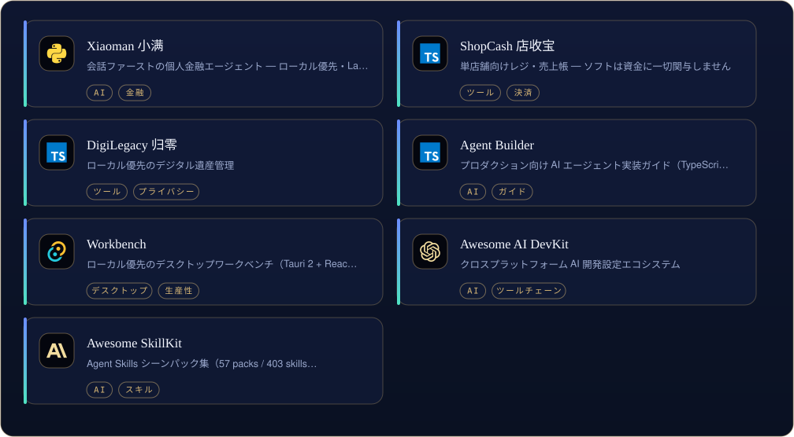
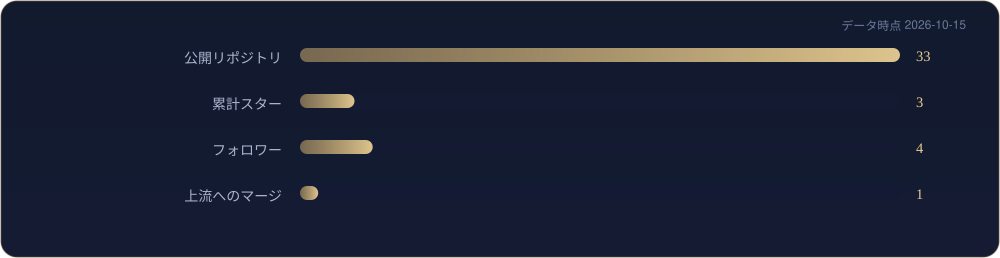

[English](README.md) | [中文](README.zh-CN.md) | [日本語](README.ja.md)

  

<i>小さく作って、頻繁に出す。</i>

First, solve the problem. Then, write the code. — John Johnson

<table border="0">
<tr>
<td valign="top" width="58%">

### について

小さく使える道具を作り、直したパッチは上流へ返します（apache/airflow などにマージ済み）。日常は TypeScript / Python。

</td>
<td valign="top" width="42%">

### 近況

- ShopCash と Xiaoman の磨き込み
- 上流への小さなパッチ（MonkeyCode #1298 レビュー中）
- ローカル優先の AI ワークフロー探究

</td>
</tr>
</table>

## 道具箱

  

## 主な作品

  

[Xiaoman 小满](https://github.com/X33834/xiaoman) · [ShopCash 店收宝](https://github.com/X33834/shopcash) · [DigiLegacy 归零](https://github.com/X33834/digilegacy) · [Naiwa 奶蛙](https://github.com/X33834/naiwa-pet) · [Agent Builder](https://github.com/X33834/agent-builder) · [Workbench](https://github.com/X33834/workbench) · [Awesome AI DevKit](https://github.com/X33834/awesome-ai-devkit) · [Awesome SkillKit](https://github.com/X33834/awesome-skillkit)

全公開リポジトリ： [github.com/X33834](https://github.com/X33834)

## 数字で見る

  
  

  

## ピン留め作品

  
  
  

## コントリビューション

  <picture>
    <source media="(prefers-color-scheme: dark)" srcset="./assets/github-contribution-grid-snake-dark.svg" />
    
  </picture>

## オープンソース

**上流マージ済み**
- [apache/airflow](https://github.com/apache/airflow) — [#73099](https://github.com/apache/airflow/pull/73099) — Support Table objects in BigQueryHook.create_table

**レビュー中**
- [chaitin/MonkeyCode](https://github.com/chaitin/MonkeyCode) — [#1298](https://github.com/chaitin/MonkeyCode/pull/1298) — frontend auto-resize fix
- [y1s11564/simona-desktop-app](https://github.com/y1s11564/simona-desktop-app) — [#1](https://github.com/y1s11564/simona-desktop-app/pull/1) · [#2](https://github.com/y1s11564/simona-desktop-app/pull/2) · [#3](https://github.com/y1s11564/simona-desktop-app/pull/3) · [#4](https://github.com/y1s11564/simona-desktop-app/pull/4) · [#5](https://github.com/y1s11564/simona-desktop-app/pull/5) · [#6](https://github.com/y1s11564/simona-desktop-app/pull/6) — upstream patch series

## 執筆

| 日付 | 記事 |
|---|---|
| 2026-09-27 | [Playwright 多平台分发：8 个踩坑与合规门禁](https://blog.csdn.net/weixin_56622231/article/details/166698802) |
| 2026-09-25 | [AI Agent 智能体开发从零到一：2026年程序员完整学习路线与实战指南](https://blog.csdn.net/weixin_56622231/article/details/166643070) |
| 2026-09-21 | [工作流体检验收：全链路发布完整性验证](https://blog.csdn.net/weixin_56622231/article/details/166254273) |
| 2026-09-21 | [Python协程全景解析：从原理到生产实战](https://blog.csdn.net/weixin_56622231/article/details/166252941) |
| 2026-09-15 | [【分布式第一课】从单机到百万级并发：一小时带你看懂分布式系统的前世今生](https://blog.csdn.net/weixin_56622231/article/details/165435117) |

同時掲載  [CSDN](https://blog.csdn.net/weixin_56622231) ·  [Juejin](https://juejin.cn/user/2350111542479753)

## ほかの場所

> 同一人物の5つの拠点 — これらのアカウントは同じ人のミラーです。

| | プラットフォーム | アカウント | 役割 |
|---|---|---|---|
|  | GitHub | **[X33834](https://github.com/X33834)** | 上流 OSS · ツールと作品 ◆ *現在地* |
|  | GitHub | **[Morningstar202604](https://github.com/Morningstar202604)** | ポートフォリオ · 長期プロジェクト |
|  | GitHub | **[badhope](https://github.com/badhope)** | プロフィール · ツール小屋 |
|  | GitCode | **[badhope](https://gitcode.com/badhope)** | モバイル開発 · オフラインツール |
|  | Gitee | **[badhope](https://gitee.com/badhope)** | ミラー · ミニアプリ |

  

© X33834

