
<a href="README.md">English</a> · <a href="README.zh-CN.md">中文</a> · <b>日本語</b>

<picture><source media="(prefers-color-scheme: dark)" srcset="assets/hero-ja-dark.svg" />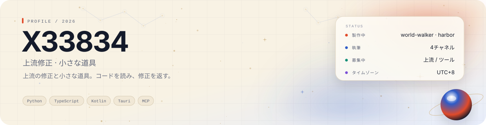</picture>

<picture><source media="(prefers-color-scheme: dark)" srcset="assets/starchart-ja-dark.svg" /></picture>

ゆっくり回る星図 · 一周一分

## 01 · いま

- **個人リポジトリ** — 28 件 · 個人名前空間、fork を除く
- **外部 PR** — 6 件：マージ 0、オープン 0、クローズ 6
- **配信** — CSDN 長文アーカイブ、Juejin・知乎・博客园 は自動運用

## 02 · 外部 PR

6 件 · マージ済み 0 · オープン 0 · クローズ 6 · +86050/−21666 · 1945 ファイル · 1 コメント

- [apache/airflow#73672](https://github.com/apache/airflow/pull/73672) — diag · **クローズ** · 提出 2026-09-24 · +85766/−21595 · 1933 ファイル · 0 コメント
- [chaitin/MonkeyCode#1298](https://github.com/chaitin/MonkeyCode/pull/1298) — fix(frontend): replace field-sizing:content with JS auto-resize to fix CJK cursor offset · **クローズ** · 提出 2026-09-17 · +14/−1 · 1 ファイル · 1 コメント
- [y1s11564/simona-desktop-app#6](https://github.com/y1s11564/simona-desktop-app/pull/6) — security: 生产环境 CSP 白名单 · **クローズ** · 提出 2026-09-15 · +23/−0 · 1 ファイル · 0 コメント
- [y1s11564/simona-desktop-app#5](https://github.com/y1s11564/simona-desktop-app/pull/5) — perf: 长会话消息渲染优化 · **クローズ** · 提出 2026-09-15 · +9/−2 · 1 ファイル · 0 コメント
- [y1s11564/simona-desktop-app#4](https://github.com/y1s11564/simona-desktop-app/pull/4) — style: design tokens / 焦点可见性 / 移动端 dvh · **クローズ** · 提出 2026-09-15 · +45/−0 · 2 ファイル · 0 コメント
- [y1s11564/simona-desktop-app#3](https://github.com/y1s11564/simona-desktop-app/pull/3) — chore: ESLint/Prettier/Vitest 工具链 + Markdown 纯函数单测 · **クローズ** · 提出 2026-09-15 · +193/−68 · 7 ファイル · 0 コメント

PR スナップショット 2026-11-24 · GitHub Search / pulls API

## 03 · 代表プロジェクト

<a href="https://github.com/X33834/CodePocket"><picture><source media="(prefers-color-scheme: dark)" srcset="assets/project-0-ja-dark.svg" />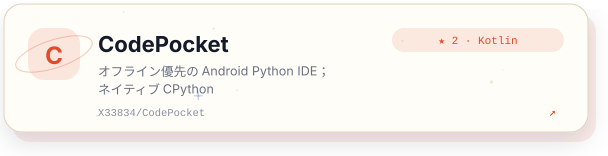</picture></a> <a href="https://github.com/X33834/harbor"><picture><source media="(prefers-color-scheme: dark)" srcset="assets/project-1-ja-dark.svg" />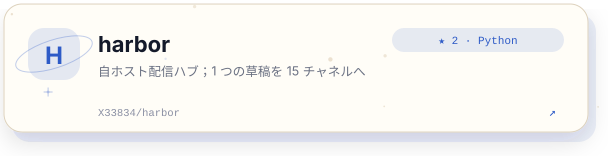</picture></a>

<a href="https://github.com/X33834/world-walker"><picture><source media="(prefers-color-scheme: dark)" srcset="assets/project-2-ja-dark.svg" />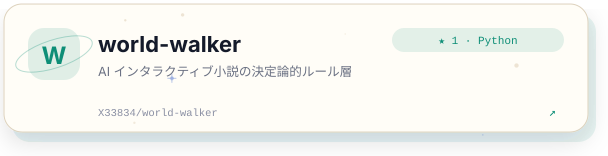</picture></a> <a href="https://github.com/X33834/bigrobot"><picture><source media="(prefers-color-scheme: dark)" srcset="assets/project-3-ja-dark.svg" />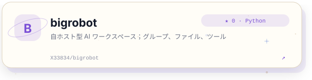</picture></a>

<a href="https://github.com/X33834/digilegacy"><picture><source media="(prefers-color-scheme: dark)" srcset="assets/project-4-ja-dark.svg" />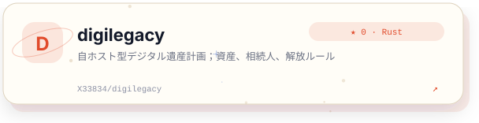</picture></a> <a href="https://github.com/X33834/mashang"><picture><source media="(prefers-color-scheme: dark)" srcset="assets/project-5-ja-dark.svg" />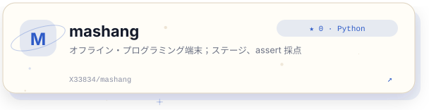</picture></a>

その他のプロジェクト: [workbench](https://github.com/X33834/workbench) · [moneyhelper](https://github.com/X33834/moneyhelper)

## 04 · 数字

<picture><source media="(prefers-color-scheme: dark)" srcset="assets/numbers-ja-dark.svg" />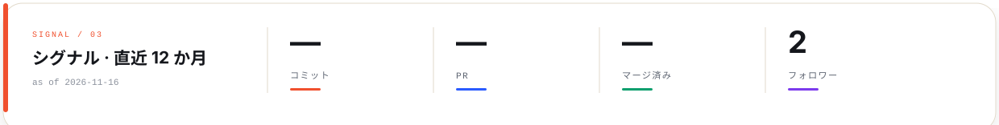</picture>

## 05 · コントリビューション

<picture><source media="(prefers-color-scheme: dark)" srcset="assets/contrib-ja-dark.svg" />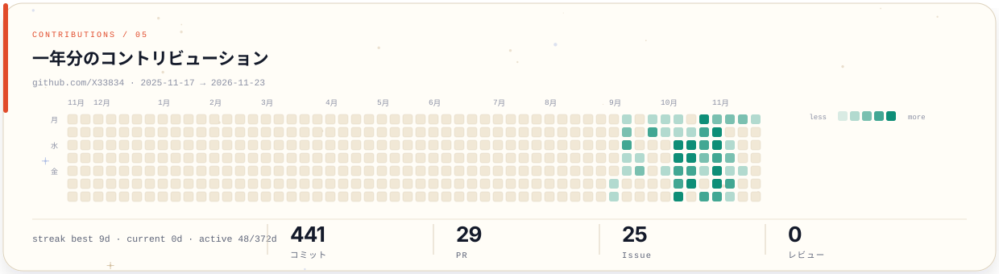</picture>

日々の寄与は GitHub GraphQL の正確なスナップショット · 毎週更新

## 06 · 言語構成

<picture><source media="(prefers-color-scheme: dark)" srcset="assets/langs-ja-dark.svg" />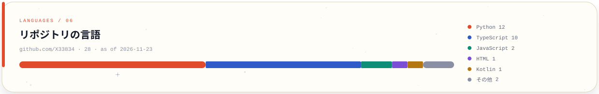</picture>

## 07 · 配信ライン

<a href="https://blog.csdn.net/weixin_56622231"><picture><source media="(prefers-color-scheme: dark)" srcset="assets/channel-csdn-ja-dark.svg" />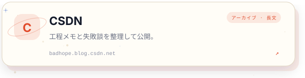</picture></a> <a href="https://juejin.cn/user/2350111542479753/posts"><picture><source media="(prefers-color-scheme: dark)" srcset="assets/channel-juejin-ja-dark.svg" /></picture></a>

<a href="https://www.zhihu.com/people/e7c851hd"><picture><source media="(prefers-color-scheme: dark)" srcset="assets/channel-zhihu-ja-dark.svg" /></picture></a> <a href="https://www.cnblogs.com/badhope"><picture><source media="(prefers-color-scheme: dark)" srcset="assets/channel-cnblogs-ja-dark.svg" />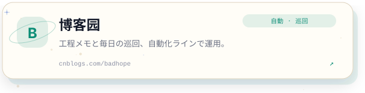</picture></a>

四つの配信アカウント。CSDN は手動アーカイブ、Juejin・知乎・博客园 は自動化ラインで運用。

CSDN 最新

- 2026-11-04 — [把 AI Agent 接进业务系统，我踩了 3 个挺蠢的坑](https://blog.csdn.net/weixin_56622231/article/details/170051167)
- 2026-10-18 — [Gemini 4 Argon 全面开放：谷歌憋了半年的旗舰大招，到底行不行？](https://blog.csdn.net/weixin_56622231/article/details/168251657)

<a href="https://blog.csdn.net/weixin_56622231">CSDN の全記事 →</a>

One source, five profiles · numbers from a local snapshot

すべてのリポジトリ: [github.com/X33834](https://github.com/X33834)
