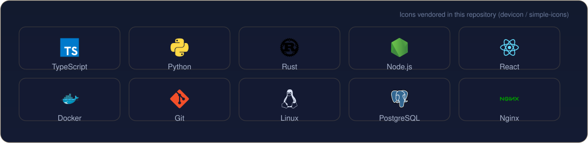

[English](README.md) | [中文](README.zh-CN.md) | [日本語](README.ja.md)

  <picture>
  <source type="image/png" srcset="./assets/png/hero.png" />
  
  </picture>

<i>Ship small, ship often.</i>

First, solve the problem. Then, write the code. — John Johnson

<table border="0">
<tr>
<td valign="top" width="58%">

### About

I build small tools that do one thing well, and send the fixes back upstream — merged into apache/airflow and friends. TypeScript and Python daily; Rust when it fits.

</td>
<td valign="top" width="42%">

### Now

- Polishing the ShopCash and Xiaoman product lines
- Small upstream patches — MonkeyCode #1298 in review
- Exploring local-first AI workflows

</td>
</tr>
</table>

## Toolbox

  

## Selected work

| Project | Stars | Updated |
| --- | --- | --- |
| [world-walker — World Walker 万界·行者 — 世界观无关的 AI 文字互动游戏内核：确定性规则结算 + 34…](https://github.com/X33834/world-walker) | 1 | 2026-10-24 |
| [aquapilot — AI-operated wastewater treatment plant simulator — topo…](https://github.com/X33834/aquapilot) | 0 | 2026-10-24 |
| [campushub — CampusHub — 校园服务平台](https://github.com/X33834/campushub) | 0 | 2026-10-24 |
| [creator-studio — 稿台 Creator Studio: 本地优先的创作者 AI 制片台（选题→资料→脚本→分镜→包装→…](https://github.com/X33834/creator-studio) | 0 | 2026-10-24 |
| [digilegacy — DigiLegacy 归零 — open-source, local-first digital legac…](https://github.com/X33834/digilegacy) | 0 | 2026-10-24 |
| [Flow — Flow · AI 原生跨境出口电商平台｜买家商城 + 卖家 AI 工作台，5 个真实 LLM Agent、人工审批式运…](https://github.com/X33834/Flow) | 0 | 2026-10-24 |

All public repositories: [github.com/X33834](https://github.com/X33834)

## Numbers

  
  
  

  
  

## Pinned work

  
  
  

## Contribution graph

  <picture>
  <source media="(prefers-color-scheme: dark)" srcset="./assets/github-contribution-grid-snake-dark.svg" />
  
  </picture>

## Open source

**Merged upstream**
- [apache/airflow](https://github.com/apache/airflow) — [#73099](https://github.com/apache/airflow/pull/73099) — Support Table objects in BigQueryHook.create_table

**In review**
- [chaitin/MonkeyCode](https://github.com/chaitin/MonkeyCode) — [#1298](https://github.com/chaitin/MonkeyCode/pull/1298) — frontend auto-resize fix
- [y1s11564/simona-desktop-app](https://github.com/y1s11564/simona-desktop-app) — [#1](https://github.com/y1s11564/simona-desktop-app/pull/1) · [#2](https://github.com/y1s11564/simona-desktop-app/pull/2) · [#3](https://github.com/y1s11564/simona-desktop-app/pull/3) · [#4](https://github.com/y1s11564/simona-desktop-app/pull/4) · [#5](https://github.com/y1s11564/simona-desktop-app/pull/5) · [#6](https://github.com/y1s11564/simona-desktop-app/pull/6) — upstream patch series

## Writing

| Date | Article |
|---|---|
| 2026-10-18 | [Gemini 4 Argon 全面开放：谷歌憋了半年的旗舰大招，到底行不行？](https://blog.csdn.net/weixin_56622231/article/details/168251657) |
| 2026-10-16 | [MCP 落地一年，我总结了 6 个没人告诉你的工程真相](https://zhuanlan.zhihu.com/p/2094232145015453253) |
| 2026-10-16 | [本地优先 AI：当所有人都在上云，我为什么把 AI 装回自己电脑](https://zhuanlan.zhihu.com/p/2094233605513991576) |
| 2026-10-16 | [AI Agent 上线前必须过的 5 道关：一个真实项目的工程手记](https://zhuanlan.zhihu.com/p/2094218858789856836) |
| 2026-09-27 | [Playwright 多平台分发：8 个踩坑与合规门禁](https://blog.csdn.net/weixin_56622231/article/details/166698802) |

Also on  <a href="https://blog.csdn.net/weixin_56622231">CSDN</a> ·  <a href="https://juejin.cn/user/2350111542479753">Juejin</a> ·  <a href="https://www.zhihu.com/people/e7c851hd">Zhihu</a>

## Elsewhere

> One identity, five homes — these five accounts mirror the same person.

| | Platform | Account | Role |
|---|---|---|---|
|  | GitHub | **[X33834](https://github.com/X33834)** | Upstream OSS · tools and works ◆ *you are here* |
|  | GitHub | **[Morningstar202604](https://github.com/Morningstar202604)** | Portfolio · long-horizon works |
|  | GitHub | **[badhope](https://github.com/badhope)** | Profile · full-stack toolshop |
|  | GitCode | **[badhope](https://gitcode.com/badhope)** | Mobile dev · offline tools |
|  | Gitee | **[badhope](https://gitee.com/badhope)** | Mirror · mini-programs |

  

© X33834

