
<b>English</b> · <a href="README.zh-CN.md">中文</a> · <a href="README.ja.md">日本語</a>

<picture><source media="(prefers-color-scheme: dark)" srcset="assets/hero-en-dark.svg" />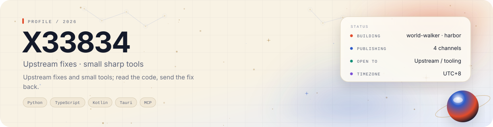</picture>

<picture><source media="(prefers-color-scheme: dark)" srcset="assets/starchart-en-dark.svg" /></picture>

A slow sky · one turn every minute

## 01 · Now

- **Personal repositories** — 28 · personal namespace, forks excluded
- **Upstream pull requests** — 6 selected: 0 merged, 0 open, 6 closed
- **Publishing** — CSDN archive; Juejin, Zhihu and Cnblogs automation

## 02 · Upstream pull requests

6 selected · 0 merged · 0 open · 6 closed · +86050/−21666 · 1945 files · 1 comments

- [apache/airflow#73672](https://github.com/apache/airflow/pull/73672) — diag · **closed** · opened 2026-09-24 · +85766/−21595 · 1933 files · 0 comments
- [chaitin/MonkeyCode#1298](https://github.com/chaitin/MonkeyCode/pull/1298) — fix(frontend): replace field-sizing:content with JS auto-resize to fix CJK cursor offset · **closed** · opened 2026-09-17 · +14/−1 · 1 file · 1 comment
- [y1s11564/simona-desktop-app#6](https://github.com/y1s11564/simona-desktop-app/pull/6) — security: 生产环境 CSP 白名单 · **closed** · opened 2026-09-15 · +23/−0 · 1 file · 0 comments
- [y1s11564/simona-desktop-app#5](https://github.com/y1s11564/simona-desktop-app/pull/5) — perf: 长会话消息渲染优化 · **closed** · opened 2026-09-15 · +9/−2 · 1 file · 0 comments
- [y1s11564/simona-desktop-app#4](https://github.com/y1s11564/simona-desktop-app/pull/4) — style: design tokens / 焦点可见性 / 移动端 dvh · **closed** · opened 2026-09-15 · +45/−0 · 2 files · 0 comments
- [y1s11564/simona-desktop-app#3](https://github.com/y1s11564/simona-desktop-app/pull/3) — chore: ESLint/Prettier/Vitest 工具链 + Markdown 纯函数单测 · **closed** · opened 2026-09-15 · +193/−68 · 7 files · 0 comments

PR snapshot 2026-11-24 · GitHub Search / pulls API

## 03 · Featured projects

<a href="https://github.com/X33834/CodePocket"><picture><source media="(prefers-color-scheme: dark)" srcset="assets/project-0-en-dark.svg" />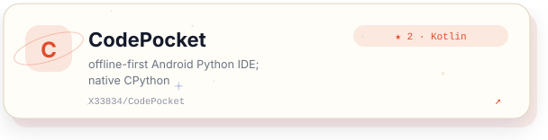</picture></a> <a href="https://github.com/X33834/harbor"><picture><source media="(prefers-color-scheme: dark)" srcset="assets/project-1-en-dark.svg" />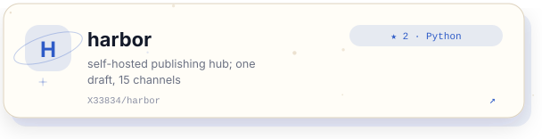</picture></a>

<a href="https://github.com/X33834/world-walker"><picture><source media="(prefers-color-scheme: dark)" srcset="assets/project-2-en-dark.svg" />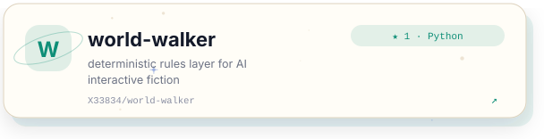</picture></a> <a href="https://github.com/X33834/bigrobot"><picture><source media="(prefers-color-scheme: dark)" srcset="assets/project-3-en-dark.svg" />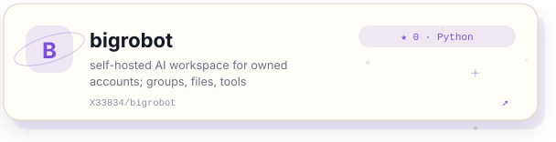</picture></a>

<a href="https://github.com/X33834/digilegacy"><picture><source media="(prefers-color-scheme: dark)" srcset="assets/project-4-en-dark.svg" />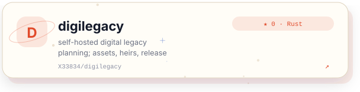</picture></a> <a href="https://github.com/X33834/mashang"><picture><source media="(prefers-color-scheme: dark)" srcset="assets/project-5-en-dark.svg" />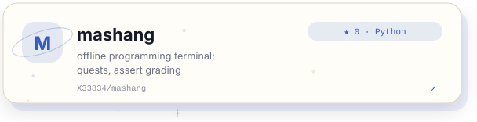</picture></a>

More projects: [workbench](https://github.com/X33834/workbench) · [moneyhelper](https://github.com/X33834/moneyhelper)

## 04 · Numbers

<picture><source media="(prefers-color-scheme: dark)" srcset="assets/numbers-en-dark.svg" /></picture>

## 05 · Contribution calendar

<picture><source media="(prefers-color-scheme: dark)" srcset="assets/contrib-en-dark.svg" />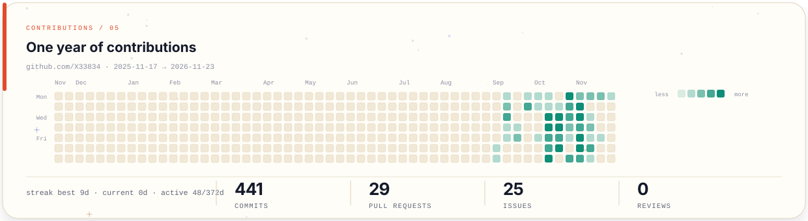</picture>

Exact daily contributions from the GitHub GraphQL snapshot · refreshed weekly

## 06 · Languages

<picture><source media="(prefers-color-scheme: dark)" srcset="assets/langs-en-dark.svg" />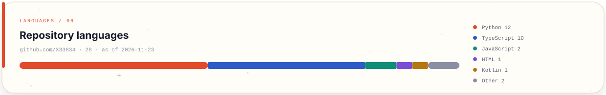</picture>

## 07 · Publishing line

<a href="https://blog.csdn.net/weixin_56622231"><picture><source media="(prefers-color-scheme: dark)" srcset="assets/channel-csdn-en-dark.svg" /></picture></a> <a href="https://juejin.cn/user/2350111542479753/posts"><picture><source media="(prefers-color-scheme: dark)" srcset="assets/channel-juejin-en-dark.svg" />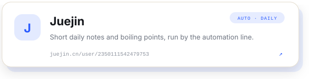</picture></a>

<a href="https://www.zhihu.com/people/e7c851hd"><picture><source media="(prefers-color-scheme: dark)" srcset="assets/channel-zhihu-en-dark.svg" /></picture></a> <a href="https://www.cnblogs.com/badhope"><picture><source media="(prefers-color-scheme: dark)" srcset="assets/channel-cnblogs-en-dark.svg" />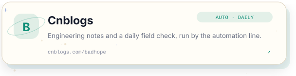</picture></a>

Four publishing accounts: CSDN is archived by hand; Juejin, Zhihu and Cnblogs run on the automation line.

Latest on CSDN

- 2026-11-04 — [把 AI Agent 接进业务系统，我踩了 3 个挺蠢的坑](https://blog.csdn.net/weixin_56622231/article/details/170051167)
- 2026-10-18 — [Gemini 4 Argon 全面开放：谷歌憋了半年的旗舰大招，到底行不行？](https://blog.csdn.net/weixin_56622231/article/details/168251657)

<a href="https://blog.csdn.net/weixin_56622231">All posts on CSDN →</a>

One source, five profiles · numbers from a local snapshot

All public repositories: [github.com/X33834](https://github.com/X33834)
