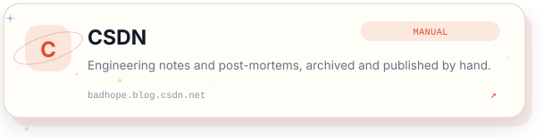

<b>English</b> · <a href="README.zh-CN.md">中文</a> · <a href="README.ja.md">日本語</a>

<picture><source media="(prefers-color-scheme: dark)" srcset="assets/hero-en-dark.svg" /></picture>

<picture><source media="(prefers-color-scheme: dark)" srcset="assets/starchart-en-dark.svg" /></picture>

A slow sky · one turn every minute

## 01 · Now

- **Personal repositories** — 28 · personal namespace, forks excluded
- **Upstream pull requests** — 2 selected: 1 merged, 0 open, 1 closed
- **Publishing** — CSDN archive; Juejin, Zhihu and Cnblogs automation

## 02 · Upstream pull requests

2 selected · 1 merged · 0 open · 1 closed · +407/−84 · 17 files · 11 comments

- [apache/airflow#73099](https://github.com/apache/airflow/pull/73099) — Support Table objects in BigQueryHook.create_table table_resource · **merged** · merged 2026-10-05 · +82/−4 · 3 files · 11 comments
- [y1s11564/simona-desktop-app#1](https://github.com/y1s11564/simona-desktop-app/pull/1) — 移动端适配：安卓原生壳 UI 美化 + Web UI 布局修复 · **closed** · opened 2026-09-13 · +325/−80 · 14 files · 0 comments

PR snapshot 2026-11-22 · GitHub Search / pulls API

## 03 · Other projects

| Project | Stack | Scope |
|---|---|---|
| [world-walker](https://github.com/X33834/world-walker) | Python stdlib · MCP | deterministic rules layer for AI interactive fiction |
| [harbor](https://github.com/X33834/harbor) | Python | self-hosted publishing hub; one draft, 15 channels |
| [CodePocket](https://github.com/X33834/CodePocket) | Kotlin · CPython 3.13 | offline-first Android Python IDE; native CPython |
| [mashang](https://github.com/X33834/mashang) | Kotlin · CPython 3.13 | offline programming terminal; quests, assert grading |
| [workbench](https://github.com/X33834/workbench) | Tauri 2 · React 19 · TypeScript | desktop workbench; clipboard, snippets, windows, quick launch |
| [digilegacy](https://github.com/X33834/digilegacy) | Rust | self-hosted digital legacy planning; assets, heirs, release rules |
| [moneyhelper](https://github.com/X33834/moneyhelper) | FastAPI · LangGraph · React | chat-first finance agent; bookkeeping, portfolio risk, filings |
| [bigrobot](https://github.com/X33834/bigrobot) | Python | self-hosted AI workspace for owned accounts; groups, files, tools |

## 04 · Numbers

<picture><source media="(prefers-color-scheme: dark)" srcset="assets/numbers-en-dark.svg" /></picture>

## 05 · Publishing line

<a href="https://blog.csdn.net/weixin_56622231"><picture><source media="(prefers-color-scheme: dark)" srcset="assets/channel-csdn-en-dark.svg" /></picture></a> <a href="https://juejin.cn/user/2350111542479753"><picture><source media="(prefers-color-scheme: dark)" srcset="assets/channel-juejin-en-dark.svg" /></picture></a>

<a href="https://www.zhihu.com/people/e7c851hd"><picture><source media="(prefers-color-scheme: dark)" srcset="assets/channel-zhihu-en-dark.svg" /></picture></a> <a href="https://www.cnblogs.com/badhope"><picture><source media="(prefers-color-scheme: dark)" srcset="assets/channel-cnblogs-en-dark.svg" /></picture></a>

Four publishing accounts: CSDN is archived by hand; Juejin, Zhihu and Cnblogs run on the automation line.

Latest on CSDN

- 2026-11-04 — [把 AI Agent 接进业务系统，我踩了 3 个挺蠢的坑](https://blog.csdn.net/weixin_56622231/article/details/170051167)
- 2026-10-18 — [Gemini 4 Argon 全面开放：谷歌憋了半年的旗舰大招，到底行不行？](https://blog.csdn.net/weixin_56622231/article/details/168251657)

<a href="https://blog.csdn.net/weixin_56622231">All posts on CSDN →</a>

One source, five profiles · numbers from a local snapshot

All public repositories: [github.com/X33834](https://github.com/X33834)
