
<a href="README.md">English</a> · <b>中文</b> · <a href="README.ja.md">日本語</a>

<picture><source media="(prefers-color-scheme: dark)" srcset="assets/hero-zh-CN-dark.svg" />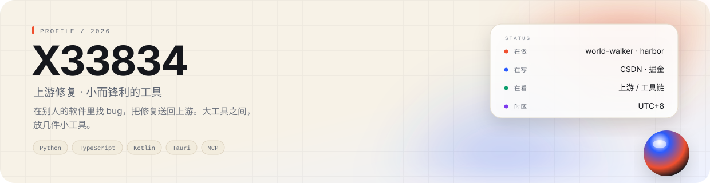</picture>

<picture><source media="(prefers-color-scheme: dark)" srcset="assets/starchart-zh-CN-dark.svg" /></picture>

缓慢旋转的星图 · 一圈一分钟

## 01 · 现在

- **个人仓库** — 28 个 · 个人命名空间，不含 fork
- **外部 PR** — 6 条：已合并 0，开放中 0，已关闭 6
- **发布** — CSDN 长文归档；掘金、知乎、博客园自动运营

## 02 · 外部 PR

6 条 · 已合并 0 · 开放中 0 · 已关闭 6 · +86050/−21666 · 1945 个文件 · 1 条评论

- [apache/airflow#73672](https://github.com/apache/airflow/pull/73672) — diag · **已关闭** · 开启于 2026-09-24 · +85766/−21595 · 1933 个文件 · 0 条评论
- [chaitin/MonkeyCode#1298](https://github.com/chaitin/MonkeyCode/pull/1298) — fix(frontend): replace field-sizing:content with JS auto-resize to fix CJK cursor offset · **已关闭** · 开启于 2026-09-17 · +14/−1 · 1 个文件 · 1 条评论
- [y1s11564/simona-desktop-app#6](https://github.com/y1s11564/simona-desktop-app/pull/6) — security: 生产环境 CSP 白名单 · **已关闭** · 开启于 2026-09-15 · +23/−0 · 1 个文件 · 0 条评论
- [y1s11564/simona-desktop-app#5](https://github.com/y1s11564/simona-desktop-app/pull/5) — perf: 长会话消息渲染优化 · **已关闭** · 开启于 2026-09-15 · +9/−2 · 1 个文件 · 0 条评论
- [y1s11564/simona-desktop-app#4](https://github.com/y1s11564/simona-desktop-app/pull/4) — style: design tokens / 焦点可见性 / 移动端 dvh · **已关闭** · 开启于 2026-09-15 · +45/−0 · 2 个文件 · 0 条评论
- [y1s11564/simona-desktop-app#3](https://github.com/y1s11564/simona-desktop-app/pull/3) — chore: ESLint/Prettier/Vitest 工具链 + Markdown 纯函数单测 · **已关闭** · 开启于 2026-09-15 · +193/−68 · 7 个文件 · 0 条评论

PR 快照 2026-11-24 · GitHub Search / pulls API

## 03 · 精选项目

<a href="https://github.com/X33834/CodePocket"><picture><source media="(prefers-color-scheme: dark)" srcset="assets/project-0-zh-CN-dark.svg" />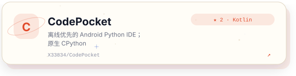</picture></a> <a href="https://github.com/X33834/harbor"><picture><source media="(prefers-color-scheme: dark)" srcset="assets/project-1-zh-CN-dark.svg" />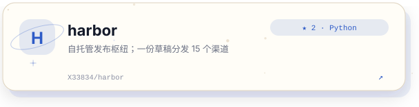</picture></a>

<a href="https://github.com/X33834/world-walker"><picture><source media="(prefers-color-scheme: dark)" srcset="assets/project-2-zh-CN-dark.svg" />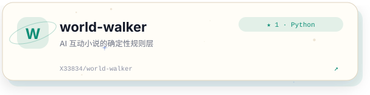</picture></a> <a href="https://github.com/X33834/bigrobot"><picture><source media="(prefers-color-scheme: dark)" srcset="assets/project-3-zh-CN-dark.svg" />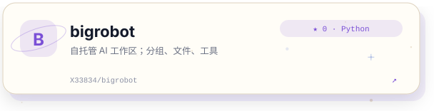</picture></a>

<a href="https://github.com/X33834/digilegacy"><picture><source media="(prefers-color-scheme: dark)" srcset="assets/project-4-zh-CN-dark.svg" />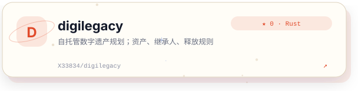</picture></a> <a href="https://github.com/X33834/mashang"><picture><source media="(prefers-color-scheme: dark)" srcset="assets/project-5-zh-CN-dark.svg" />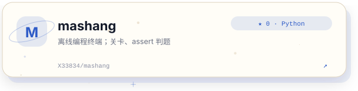</picture></a>

更多项目: [workbench](https://github.com/X33834/workbench) · [moneyhelper](https://github.com/X33834/moneyhelper)

## 04 · 数据

<picture><source media="(prefers-color-scheme: dark)" srcset="assets/numbers-zh-CN-dark.svg" /></picture>

## 05 · 贡献日历

<picture><source media="(prefers-color-scheme: dark)" srcset="assets/contrib-zh-CN-dark.svg" />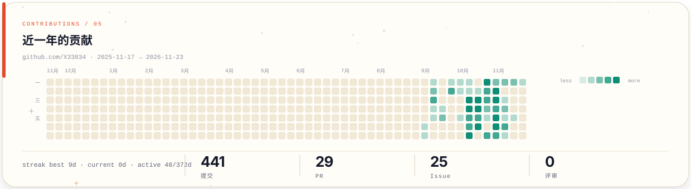</picture>

逐日贡献来自 GitHub GraphQL 精确快照 · 每周刷新

## 06 · 语言构成

<picture><source media="(prefers-color-scheme: dark)" srcset="assets/langs-zh-CN-dark.svg" />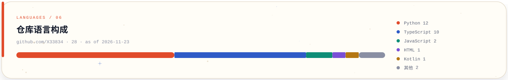</picture>

## 07 · 发布管线

<a href="https://blog.csdn.net/weixin_56622231"><picture><source media="(prefers-color-scheme: dark)" srcset="assets/channel-csdn-zh-CN-dark.svg" />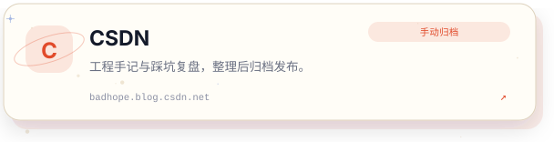</picture></a> <a href="https://juejin.cn/user/2350111542479753/posts"><picture><source media="(prefers-color-scheme: dark)" srcset="assets/channel-juejin-zh-CN-dark.svg" /></picture></a>

<a href="https://www.zhihu.com/people/e7c851hd"><picture><source media="(prefers-color-scheme: dark)" srcset="assets/channel-zhihu-zh-CN-dark.svg" /></picture></a> <a href="https://www.cnblogs.com/badhope"><picture><source media="(prefers-color-scheme: dark)" srcset="assets/channel-cnblogs-zh-CN-dark.svg" />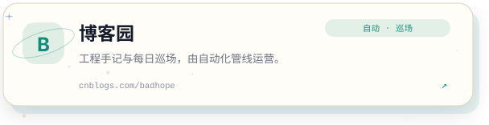</picture></a>

四个发布账号：CSDN 手动归档；掘金、知乎、博客园由自动化管线运营。

CSDN 最近

- 2026-11-04 — [把 AI Agent 接进业务系统，我踩了 3 个挺蠢的坑](https://blog.csdn.net/weixin_56622231/article/details/170051167)
- 2026-10-18 — [Gemini 4 Argon 全面开放：谷歌憋了半年的旗舰大招，到底行不行？](https://blog.csdn.net/weixin_56622231/article/details/168251657)

<a href="https://blog.csdn.net/weixin_56622231">CSDN 全部文章 →</a>

One source, five profiles · numbers from a local snapshot

全部仓库: [github.com/X33834](https://github.com/X33834)
