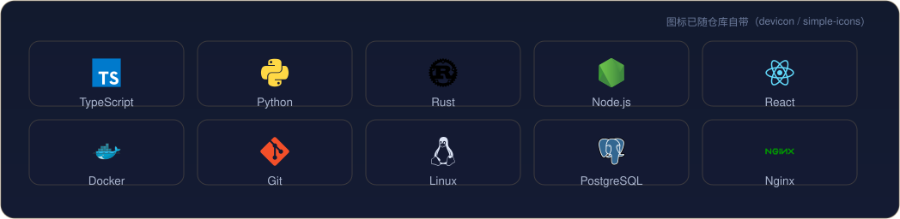
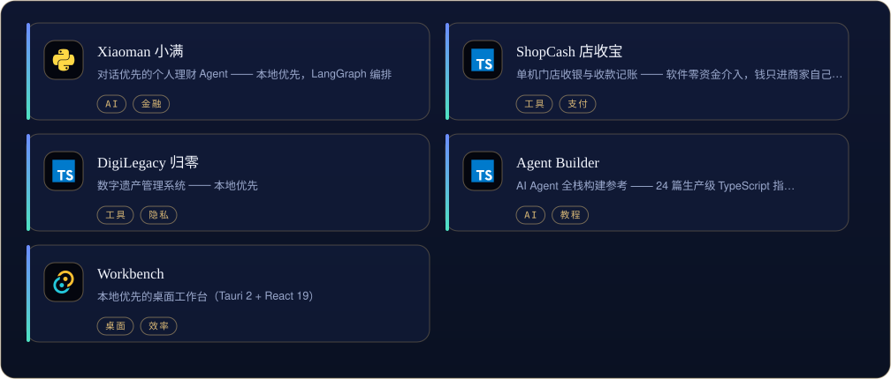

[English](README.md) | [中文](README.zh-CN.md) | [日本語](README.ja.md)

  

<i>小步快跑，持续交付。</i>

先解决问题，再写代码。 — John Johnson

<table border="0">
<tr>
<td valign="top" width="58%">

### 关于

把想法做成能用的小工具，也把修好的补丁送回上游 —— 已合入 apache/airflow 等项目。日常 TypeScript / Python，合适的地方写 Rust。

</td>
<td valign="top" width="42%">

### 近期

- 打磨 ShopCash 与 Xiaoman 两条产品线
- 给上游递小补丁 —— MonkeyCode #1298 评审中
- 探索本地优先的 AI 工作流

</td>
</tr>
</table>

## 工具箱

  

## 精选作品

  

<a href="https://github.com/X33834/xiaoman">Xiaoman 小满</a> · <a href="https://github.com/X33834/shopcash">ShopCash 店收宝</a> · <a href="https://github.com/X33834/digilegacy">DigiLegacy 归零</a> · <a href="https://github.com/X33834/naiwa-pet">Naiwa 奶蛙</a> · <a href="https://github.com/X33834/agent-builder">Agent Builder</a> · <a href="https://github.com/X33834/workbench">Workbench</a> · <a href="https://github.com/X33834/awesome-ai-devkit">Awesome AI DevKit</a> · <a href="https://github.com/X33834/awesome-skillkit">Awesome SkillKit</a>

全部公开仓库： [github.com/X33834](https://github.com/X33834)

## 数据

  
  

  

## 置顶作品

  
  
  

## 贡献图

  <picture>
    <source media="(prefers-color-scheme: dark)" srcset="./assets/github-contribution-grid-snake-dark.svg" />
    
  </picture>

## 开源足迹

**已合并上游**
- [apache/airflow](https://github.com/apache/airflow) — [#73099](https://github.com/apache/airflow/pull/73099) — Support Table objects in BigQueryHook.create_table

**评审中**
- [chaitin/MonkeyCode](https://github.com/chaitin/MonkeyCode) — [#1298](https://github.com/chaitin/MonkeyCode/pull/1298) — frontend auto-resize fix
- [y1s11564/simona-desktop-app](https://github.com/y1s11564/simona-desktop-app) — [#1](https://github.com/y1s11564/simona-desktop-app/pull/1) · [#2](https://github.com/y1s11564/simona-desktop-app/pull/2) · [#3](https://github.com/y1s11564/simona-desktop-app/pull/3) · [#4](https://github.com/y1s11564/simona-desktop-app/pull/4) · [#5](https://github.com/y1s11564/simona-desktop-app/pull/5) · [#6](https://github.com/y1s11564/simona-desktop-app/pull/6) — upstream patch series

## 写作

| 日期 | 文章 |
|---|---|
| 2026-10-16 | [MCP 落地一年，我总结了 6 个没人告诉你的工程真相](https://zhuanlan.zhihu.com/p/2094232145015453253) |
| 2026-10-16 | [本地优先 AI：当所有人都在上云，我为什么把 AI 装回自己电脑](https://zhuanlan.zhihu.com/p/2094233605513991576) |
| 2026-10-16 | [AI Agent 上线前必须过的 5 道关：一个真实项目的工程手记](https://zhuanlan.zhihu.com/p/2094218858789856836) |
| 2026-09-27 | [Playwright 多平台分发：8 个踩坑与合规门禁](https://blog.csdn.net/weixin_56622231/article/details/166698802) |
| 2026-09-25 | [AI Agent 智能体开发从零到一：2026年程序员完整学习路线与实战指南](https://blog.csdn.net/weixin_56622231/article/details/166643070) |

同步发布  <a href="https://blog.csdn.net/weixin_56622231">CSDN</a> ·  <a href="https://juejin.cn/user/2350111542479753">Juejin</a> ·  <a href="https://www.zhihu.com/people/e7c851hd">Zhihu</a>

## 在别处

> 同一身份，五处安放 —— 这五个账号同属一人，互为镜像。

| | 平台 | 账号 | 定位 |
|---|---|---|---|
|  | GitHub | **[X33834](https://github.com/X33834)** | 上游开源 · 工具与作品 ◆ *你在这里* |
|  | GitHub | **[Morningstar202604](https://github.com/Morningstar202604)** | 作品集 · 长期项目 |
|  | GitHub | **[badhope](https://github.com/badhope)** | 个人主页 · 全栈工具馆 |
|  | GitCode | **[badhope](https://gitcode.com/badhope)** | 移动端开发 · 离线工具 |
|  | Gitee | **[badhope](https://gitee.com/badhope)** | 作品镜像 · 小程序 |

  

© X33834

